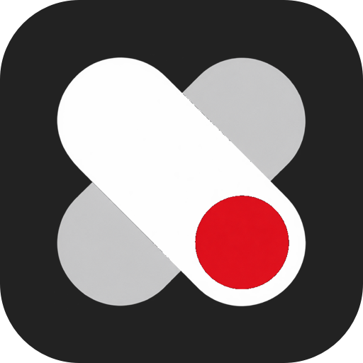

<p align="center">
  
</p>

<h1 align="center">NothingX Desktop</h1>
<p align="center"><strong>Your Nothing and CMF controls, one click away.</strong><br>
A lightweight menu-bar and tray companion for macOS and Windows.</p>

<p align="center">
  <a href="#get-started">Get started</a> ·
  <a href="#features">Features</a> ·
  <a href="#build-from-source">Build from source</a> ·
  <a href="https://github.com/nipunyatawara-dev/NothingX-Desktop/issues">Report an issue</a>
</p>

> **Credit where it belongs:** This project builds on **[Nothing X Mac](https://github.com/yashraut362/nothing-x-mac) by [Yash Raut](https://github.com/yashraut362)**. His open-source application, panel design and Bluetooth work made this rebuild possible. Thanks also to the **[Radiance ear-web contributors](https://github.com/radiance-project/ear-web)** for the underlying protocol and device knowledge.

Rebuilt with **Rust and the system webview**, NothingX Desktop keeps the familiar
compact panel while replacing the Electron runtime. Check your battery, change
noise control and adjust supported earbud settings from the menu bar or taskbar.

**In development.** The first public release is coming after further polish and
testing. Source builds are available now; there is no published installer yet.

## Features

- **Battery at a glance.** Left, right and case levels, plus charging state when reported by your device.
- **Noise and sound controls.** ANC, transparency, bass, EQ presets and custom EQ on supported models.
- **Your everyday settings.** In-ear detection, low latency, spatial audio, dual connection and gesture mappings, where supported.
- **A compact, familiar panel.** Blurred translucent material on macOS, sharp icons, light/dark appearance and a menu-bar mark that preserves its red accent.
- **A smaller desktop companion.** Rust handles device state and Bluetooth, while the operating system supplies the webview. No bundled Chromium runtime.

Available controls depend on the headphone model and firmware. Missing battery
readings stay unknown rather than showing a misleading zero.

## Platform and device support

| Platform | Current status |
| --- | --- |
| macOS 13+, Apple Silicon | Built and exercised with **CMF Buds 2 Plus** |
| macOS 13+, Intel | Included in the universal build; Intel runtime testing pending |
| Windows 10/11, x64 | Cross-built and compile checked; native UI and Bluetooth testing pending |

**CMF Buds 2 Plus is the primary test device.** Profiles for other Nothing and
CMF models are carried over from the upstream projects, but have not all been
verified on hardware. A model profile is not a guarantee of compatibility.

## Get started

1. [Build the app](#build-from-source). On macOS open `dist/NothingX Desktop.app`. On Windows extract the portable ZIP and keep `WebView2Loader.dll` beside the executable.
2. Pair and connect your headphones in the system's Bluetooth settings. Allow Bluetooth access when macOS asks.
3. **Left-click the menu-bar or tray icon** to open the panel. Click outside to dismiss it. Use the panel's **power button** to quit. Right-click has no menu.

The app discovers headphones that are already connected, including after an app
restart. First status readings can take about eight seconds on the tested Mac.
If another desktop controller or the phone companion app is holding the control
channel, close it and let NothingX Desktop retry. Audio pairing stays with the
operating system.

Some models restart when dual connection is changed; the panel identifies that
action. Remove earbuds before using Find sounds. A sound stops automatically
after 30 seconds, and **Stop Sound** ends it sooner.

## Build from source

Clone this repository first:

```sh
git clone https://github.com/nipunyatawara-dev/NothingX-Desktop.git
cd NothingX-Desktop
```

### macOS

Install a current Rust toolchain and Xcode Command Line Tools with Swift 6.

```sh
# Build for your Mac
bash scripts/build-macos.sh

# Or build a universal app for Apple Silicon and Intel
rustup target add aarch64-apple-darwin x86_64-apple-darwin
bash scripts/build-macos.sh --universal

open "dist/NothingX Desktop.app"
```

The script creates the application, a ZIP, corresponding source and dependency
notices in `dist/`. macOS builds are ad-hoc signed and are not notarized.

### Windows

Install Rust's MSVC toolchain, Visual Studio C++ Build Tools and the
[Microsoft Edge WebView2 Runtime](https://developer.microsoft.com/microsoft-edge/webview2/).
Run this from PowerShell:

```powershell
powershell -ExecutionPolicy Bypass -File scripts/build-windows.ps1
```

The script creates a portable ZIP in `dist/`, including `WebView2Loader.dll`.
Windows builds are unsigned.

## Under the hood

Rust owns protocol parsing, device state, reconnection and application lifecycle.
[Wry](https://github.com/tauri-apps/wry) hosts the existing HTML/CSS/JavaScript
panel in WKWebView on macOS and WebView2 on Windows. A small Swift IOBluetooth
helper provides macOS RFCOMM; Windows uses native RFCOMM sockets from Rust.
The panel needs no Node.js runtime or frontend build pipeline.

The current universal macOS application is approximately **6 MiB**.
See the [validation notes](docs/VALIDATION.md) for measured memory use, hardware
checks and their limits. Webview processes still consume memory; this project
does not claim a measured RAM reduction against the original app.

<details>
<summary><strong>Development and verification</strong></summary>

```sh
cargo test --locked
cargo fmt --check
cargo clippy --all-targets -- -D warnings

# UI simulation; no Bluetooth helper or device changes
cargo run -- --simulate "CMF Buds 2 Plus" --open

# After building the macOS Bluetooth helper
cargo run
```

Protocol tests cover reference packets, CRC, fragmented and malformed messages,
battery decoding, confirmed changes, timeouts and disconnect cleanup.
Simulation supports UI work without changing headphone settings.

See the [architecture notes](docs/PLAN.md), [validation record](docs/VALIDATION.md)
and [artwork notes](docs/BRANDING.md). Device-specific bug reports are most useful
with the model, firmware, OS version and steps to reproduce.

</details>

## Credits and license

Maintained by [Nipun Yatawara](https://github.com/nipunyatawara-dev).
Original application and panel: **[Yash Raut / Nothing X Mac](https://github.com/yashraut362/nothing-x-mac)**.
Protocol and device lineage: **[Radiance ear-web](https://github.com/radiance-project/ear-web)**.

Distributed under **[AGPL-3.0-only](LICENSE)**. Retained upstream credits and
license notices are in [THIRD_PARTY.md](THIRD_PARTY.md).

NothingX Desktop is an unofficial community project, unaffiliated with and not
endorsed by Nothing or CMF. Product names and trademarks belong to their owners.
