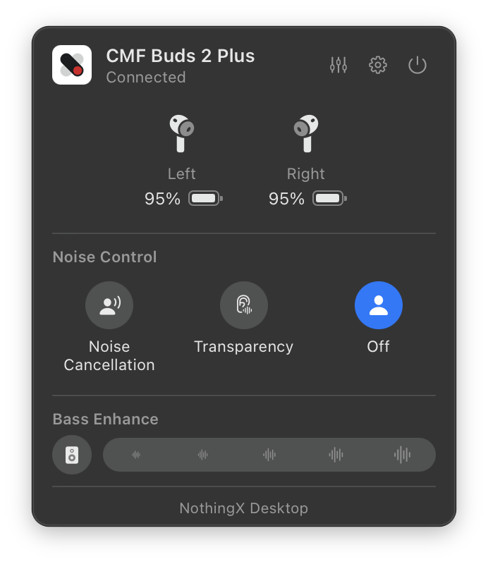
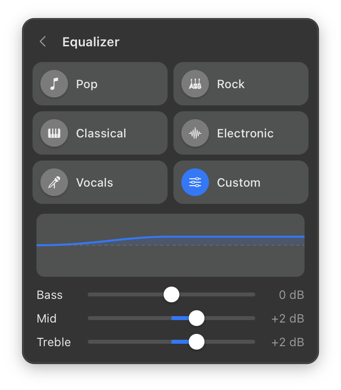
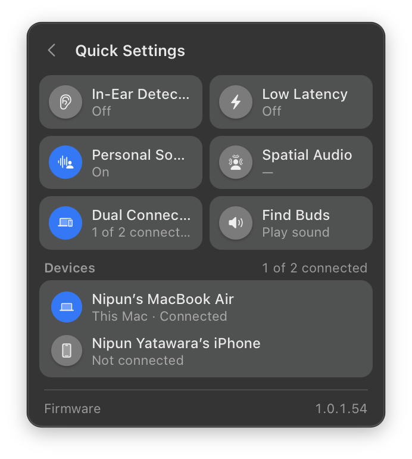
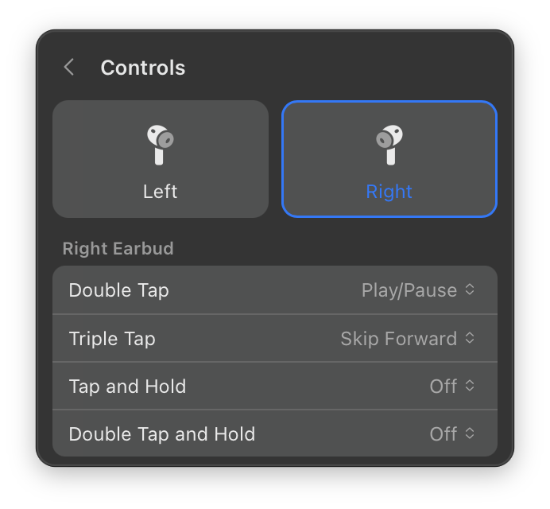

<p align="center">
  
</p>

<h1 align="center">NothingX Desktop</h1>
<p align="center"><strong>Your Nothing and CMF controls, one click away.</strong><br>
A lightweight menu-bar and tray companion for macOS and Windows.</p>

<p align="center">
  <a href="https://github.com/nipunyatawara-dev/NothingX-Desktop/releases/tag/v1.0">Download 1.0</a> ·
  <a href="#get-started">Get started</a> ·
  <a href="#features">Features</a> ·
  <a href="#build-from-source">Build from source</a> ·
  <a href="https://github.com/nipunyatawara-dev/NothingX-Desktop/issues">Report an issue</a>
</p>

> **Credit where it belongs:** This project builds on **[Nothing X Mac](https://github.com/yashraut362/nothing-x-mac) by [Yash Raut](https://github.com/yashraut362)**. The original UI design and panel layout are his work, retained in this rebuild with updated branding. His open-source application and Bluetooth work made this rebuild possible. Thanks also to the **[Radiance ear-web contributors](https://github.com/radiance-project/ear-web)** for the underlying protocol and device knowledge.

Rebuilt with **Rust and the system webview**, NothingX Desktop keeps the familiar
compact panel while replacing the Electron runtime. Check your battery, change
noise control and adjust supported earbud settings from the menu bar or taskbar.

**Version 1.0 is available. Whole app is just 4.5MB.** 
Choose your Mac architecture below, or use the Windows x64 installer. Windows runtime testing is still pending.

| Download | Requirements |
| --- | --- |
| [macOS · Apple Silicon DMG](https://github.com/nipunyatawara-dev/NothingX-Desktop/releases/download/v1.0/NothingX-Desktop-1.0.0-macos-arm64.dmg) | macOS 13+, M-series Mac |
| [macOS · Intel DMG](https://github.com/nipunyatawara-dev/NothingX-Desktop/releases/download/v1.0/NothingX-Desktop-1.0.0-macos-intel.dmg) | macOS 13+, Intel Mac; runtime testing pending |
| [Windows · x64 installer](https://github.com/nipunyatawara-dev/NothingX-Desktop/releases/download/v1.0/NothingX-Desktop-1.0.0-windows-x64-setup.exe) | Windows 10/11 x64; runtime testing pending |

The Mac builds are ad-hoc signed and unnotarized; Windows builds are unsigned.
The Windows installer installs WebView2 only if missing, which needs internet
access. All packages are built locally, without GitHub Actions.

### macOS first launch

The macOS builds are ad-hoc signed and unnotarized, so macOS may block the first launch with a warning that it cannot verify the developer or the app.

1. Open the DMG, drag `NothingX Desktop.app` to **Applications**, then try to open the app from **Applications**.
2. If macOS blocks it, go to **System Settings > Privacy & Security**, scroll down, click **Open Anyway**, and confirm. [Apple’s first-launch instructions](https://support.apple.com/en-us/102445)
3. If **Open Anyway** is unavailable and you downloaded the DMG from this project’s GitHub release, run the following in Terminal, then open the app again from **Applications**.

   ```sh
   xattr -dr com.apple.quarantine "/Applications/NothingX Desktop.app"
   ```

The command removes the quarantine flag from the installed app bundle.

## Features

- **Battery at a glance.** Left, right and case levels, plus charging state when reported by your device.
- **Noise and sound controls.** ANC, transparency, bass, EQ presets and custom EQ on supported models.
- **Your everyday settings.** In-ear detection, low latency, spatial audio, dual connection and gesture mappings, where supported.
- **A compact, familiar panel.** Blurred translucent material on macOS, sharp icons, light/dark appearance and a menu-bar mark that preserves its red accent.
- **A smaller desktop companion.** Rust handles device state and Bluetooth, while the operating system supplies the webview. No bundled Chromium runtime.

Available controls depend on the headphone model and firmware. Missing battery
readings stay unknown rather than showing a misleading zero.

## Screenshots

**Original UI design and panel layout by [Yash Raut](https://github.com/yashraut362),
creator of [Nothing X Mac](https://github.com/yashraut362/nothing-x-mac).**
These screenshots show the NothingX Desktop rebuild with CMF Buds 2 Plus.

| Battery and noise control | Equalizer |
| --- | --- |
|  |  |

| Quick Settings | Earbud controls |
| --- | --- |
|  |  |

## Platform and device support

| Platform | Status |
| --- | --- |
| macOS 13+, Apple Silicon | Tested with CMF Buds 2 Plus (2 to 3 hours of use) |
| macOS 13+, Intel | Built in universal binary; runtime testing pending |
| Windows 10/11, x64 | Cross-built and compile-checked; runtime and Bluetooth testing pending |

Only **CMF Buds 2 Plus** is tested on hardware. Other Nothing and CMF profiles come from upstream and may behave differently.

## Get started

1. Download a release above, or install with Homebrew on macOS:

   ```sh
   brew install --cask nipunyatawara-dev/tap/nothingx-desktop
   ```

2. Follow the [macOS first-launch steps](#macos-first-launch) if you downloaded the DMG. On Windows, run the setup executable. If SmartScreen appears, click **More info** (or **View more**), then **Run anyway**.
3. Pair your earbuds in system Bluetooth settings and allow Bluetooth access if macOS prompts.
4. Left-click the menu-bar or tray icon to open the panel, click outside to hide it, and use the panel's power button to quit.

If status does not appear after a few seconds, close any other Nothing or CMF app holding the Bluetooth control channel so NothingX Desktop can connect. Remove earbuds before playing Find sounds (stops automatically after 30 seconds, or click **Stop Sound**).

## Build from source

```sh
git clone https://github.com/nipunyatawara-dev/NothingX-Desktop.git
cd NothingX-Desktop
```

### macOS

Requires Rust, Python 3.11+, and Xcode Command Line Tools (Swift 6):

```sh
# Current Mac
bash scripts/build-macos.sh

# Universal (Apple Silicon + Intel)
rustup target add aarch64-apple-darwin x86_64-apple-darwin
bash scripts/build-macos.sh --universal

open "dist/NothingX Desktop.app"
```

### Windows

Requires Rust (MSVC), Visual Studio C++ Build Tools, Python 3.11+, NSIS (`makensis` on `PATH`), and the [WebView2 Runtime](https://developer.microsoft.com/microsoft-edge/webview2/):

```powershell
powershell -ExecutionPolicy Bypass -File scripts/build-windows.ps1
```

Outputs land in `dist/`. To cross-build all macOS and Windows release artifacts from macOS, install `mingw-w64` and `nsis` via Homebrew, add the `aarch64-apple-darwin`, `x86_64-apple-darwin`, and `x86_64-pc-windows-gnu` Rust targets, then run `bash scripts/build-release.sh`.

## Under the hood

Rust handles protocol parsing, device state, and reconnection. [Wry](https://github.com/tauri-apps/wry) renders the HTML/CSS/JS panel in WKWebView on macOS and WebView2 on Windows. Bluetooth RFCOMM runs through a small Swift IOBluetooth helper on macOS and native WinSock sockets on Windows, with no Node.js runtime or frontend build step.

<details>
<summary>Development and verification</summary>

```sh
cargo test --locked
cargo fmt --check
cargo clippy --all-targets -- -D warnings
node scripts/check-ui.cjs

# Live run (after building the macOS Bluetooth helper)
cargo run
```

See [PLAN.md](docs/PLAN.md), [VALIDATION.md](docs/VALIDATION.md), and [BRANDING.md](docs/BRANDING.md) for architecture notes, memory measurements, and artwork details.

</details>

## Credits and license

Maintained by [Nipun Yatawara](https://github.com/nipunyatawara-dev). Original app and UI by [Yash Raut (Nothing X Mac)](https://github.com/yashraut362/nothing-x-mac), with protocol work from [Radiance ear-web](https://github.com/radiance-project/ear-web).

Licensed under [AGPL-3.0-only](LICENSE). Third-party notices are in [THIRD_PARTY.md](THIRD_PARTY.md). Unofficial community project, unaffiliated with Nothing or CMF.
